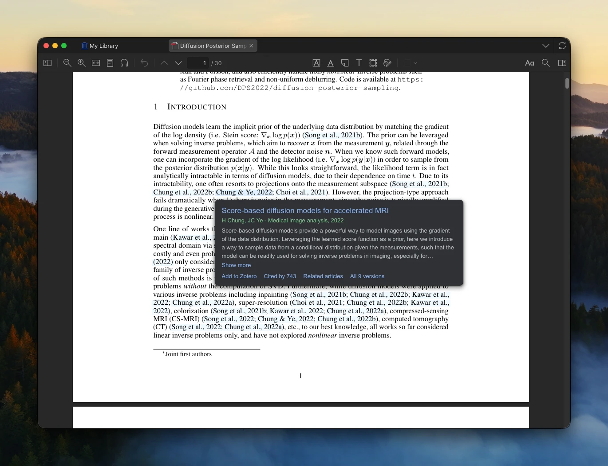

# Citation Cards for Zotero

Citation Cards opens a card with a paper's title, authors, abstract, and links when you click its citation in Zotero's PDF reader, as Google Scholar's PDF Reader does.

Citation Cards runs on Zotero 10 and 11.

## Install

Download `citation-cards.xpi` from the [latest release](https://github.com/shamus-li/zotero-citation-cards/releases/latest). In Zotero, open Tools → Plugins, click the gear icon, choose Install Plugin From File, and select the download.

## Google Scholar and OpenAlex

Citation Cards uses Google Scholar if you sign in to Google inside Zotero and [OpenAlex](https://openalex.org) otherwise. To sign in, open the Citation Cards page in Zotero's settings and click Sign in to Google Scholar.

Citation Cards switches to OpenAlex for 30 minutes when Google Scholar asks for a CAPTCHA. To return to Google Scholar sooner, click Open Google Scholar on the card, solve the CAPTCHA, and close the window.

OpenAlex allows each network about 100 lookups a day. An API key from [openalex.org/settings/api](https://openalex.org/settings/api) raises the limit to about 1,000. Enter the key on the Citation Cards settings page.

## Reporting bugs

In Zotero, choose Help → Debug Output Logging → Enable, reproduce the bug, and choose Help → Debug Output Logging → Submit Debug Output. Include the Debug ID in an [issue](https://github.com/shamus-li/zotero-citation-cards/issues).
